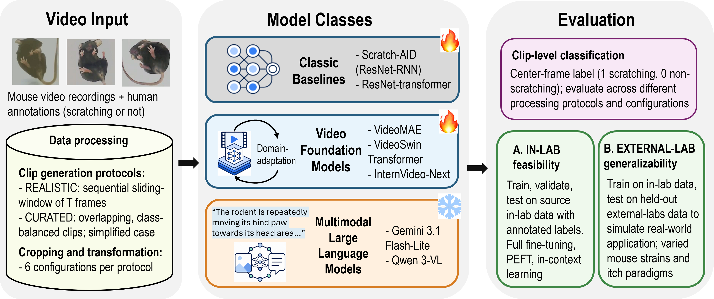

## Scratch-AID+: Towards Robust Automated Mouse Scratching Behavior Detection for Itch Research

This repository holds the official code for the paper [Towards Robust Automated Mouse Scratching Behavior Detection for Itch Research](https://doi.org/10.64898/2026.10.12.758682) in which we represent the Scratch-AID+ framework.



### 🎯 Abstract
Quantification of scratching behavior is essential for preclinical itch research using mouse model. Automated detection strategies could greatly improve quantification efficiency compared with laborious manual annotation. however, robust performance across laboratories remains a challenge for current automated methods. We present Scratch-AID+, a framework dedicated to automated mouse scratching detection, including a diverse and progressive set of approaches: classic ResNet-based detectors, task-adaptive fine-tuning of video foundation models, and in-context learning with advanced multimodal large language models. To simulate real-world use cases, we benchmark on a public dataset and utilize additional cross-laboratory video recordings for independent testing. We find that classic baselines suffered severe performance degradation on external data under the realistic setting with sparse scratching events. In contrast, fine-tuned video foundation models improved the generalizability , achieving higher detection performance. Furthermore, frozen multimodal large language models demonstrated promising out-of-the-box ability using only few-shot demonstrations. We also reported the effects of different video preprocessing strategies. Our findings highlight the improved performance and generalizability of the adapted foundation models for automated scratching behavior analysis and shed light on the real-world deployment of such detectors.


### 🔨  Scope and Use
Each model has its own folder. The binary label convention is
`0 = nonscratching`, `1 = scratching`.

| Folder | Included content |
| --- | --- |
| [scratchaid_crnn](scratchaid_crnn/) | Original ResNet18 encoder and recurrent decoder |
| [resnet_transformer](resnet_transformer/) | CNNTransformer: ResNet18 with center-frame temporal readout |
| [internvideo_next](internvideo_next/) | Base classifier, attentive probe and LoRA implementation |
| [video_swin](video_swin/) | Standalone Swin-B model configuration for MMAction2 |
| [videomae](videomae/) | VideoMAE classifier core and ViT-B/16 / ViT-L/16 factories |
| [gemini](gemini/) | Gemini 3.1 Flash-Lite prompts and retrieval/request settings |
| [qwen3_vl](qwen3_vl/) | Exact zero-, two- and four-shot prompts and source settings |

This repository contains core model definitions, ICL prompts and reported
supplementary methods/results. Raw data, preprocessing, training and evaluation
pipelines, checkpoints, logs and per-clip predictions are outside its scope.
Follow each folder's README for its input
contract, dependencies and a model-construction example. Use separate
environments where model dependencies differ. ICL prompt files can be read
without installing a model runtime.

### 📝Supplementary Materials

- [Table S1: detailed benchmark results](supplementary/table_s1.md), including
  accuracy and scratching-class F1 for Realistic and Curated, plus downloadable
  per-configuration and configuration-mean CSVs.
- [Supplementary implementation details](supplementary/implementation_details.md):
  model-specific inputs, optimization, checkpoint selection and ICL settings.
- [Table S2: Curated-to-Realistic checkpoint transfer](supplementary/table_s2.md),
  with a downloadable CSV for both test domains.

S1 distinguishes full-test trainable models from frozen MLLMs evaluated on
balanced subsamples. Detailed accuracy and scratching-class F1 are complete
for all seven models, both protocols and all six preprocessing configurations.
Configuration means reconcile with manuscript Table II. See the
[supplementary index](supplementary/README.md) for evaluation protocols and file descriptions.


### 🤝 Acknowledgements
This work was supported in part by seed funding from the PSOM AI2D Center at Penn (L.S.) and  NIH grant R01-NS-131209 (W.L.).


### 📚 Citation

```
@article {Yang2026.10.12.758682,
	author = {Yang, Shu and Pan, Anyu and Shin, Hyowon and Chen, Hongzhuo and Zhang, Zhao and Shad, Azim and Huang, William and Liu, Yang and Liu, Wesley and Luo, Helen and Xu, Chentianye and Chen, Jiong and Xu, Min and Luo, Wenqin and Yu, Huasheng and Shen, Li},
	title = {Towards Robust Automated Mouse Scratching Behavior Detection for Itch Research},
	year = {2026},
	doi = {10.64898/2026.10.12.758682}，
	journal = {IEEE BIBM Workshop on Artificial Intelligence for Biomedical Signals}
}
```